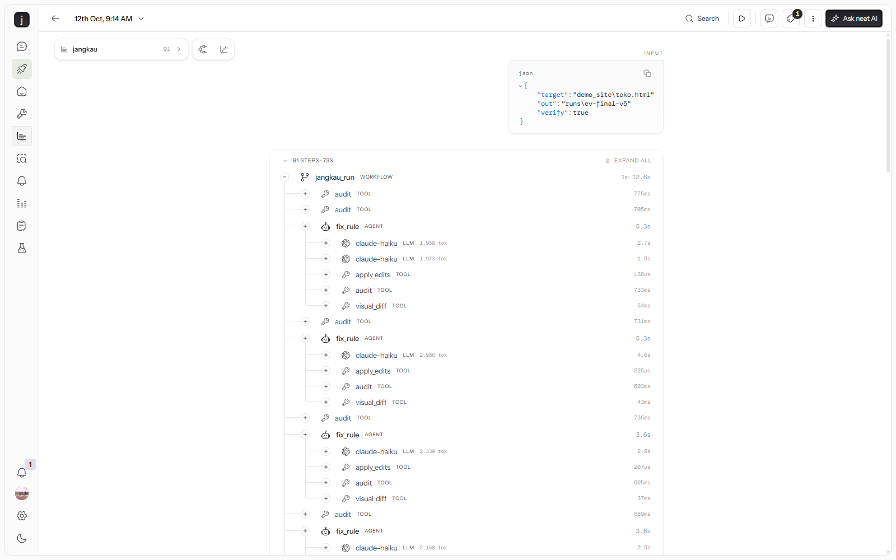

# Jangkau

> *jangkau* (Indonesian): to reach. A web page should reach everyone.

**Jangkau is an agent that makes a web page accessible, and proves every fix.** · [Live demo](https://jangkau-jet.vercel.app)
It audits the page against WCAG with axe-core, fixes one violation at a time,
and only keeps a fix when five independent checks pass. Otherwise it rolls the
edit back and tries again with the reason it failed.

About 1 in 6 people live with a disability, and the European Accessibility Act has
been enforceable since June 2025. Most small sites still fail basic checks.
Audit tools only list the problems. Jangkau fixes them.

Built during [#neatHack](https://neatlogs.com/hackathon), Oct 10–12 2026.

## How it works

```
audit (axe-core + screenshot + content fingerprint)
  └─ for each violation, most severe first
       ├─ LLM proposes find/replace edits
       ├─ apply  ── find not unique / bad JSON? ──► retry with the error
       ├─ re-audit + verify:
       │    1. the rule's failing nodes went down
       │    2. no new violations appeared
       │    3. no content was deleted (elements + text length)
       │    4. no empty landmark was added (an empty <main> games axe)
       │    5. the page still looks the same (pixel diff ≤ 35%; edge diff
       │       for contrast fixes, so a recolour passes but a moved layout fails)
       ├─ any check fails ──► revert, retry with the measured failure (max 3,
       │                       the last attempt escalates to a stronger model)
       └─ checkpoint state.json (an interrupted run resumes)
final audit ──► report.md (before/after, tokens, time)
--pr ──► branch + commit the fixed page in its repo, open a PR with the report
```

The content guard matters. The cheapest way for an LLM to "fix" a missing alt
attribute is to delete the image. Jangkau catches that and reverts it.

| Focus area | In Jangkau |
|---|---|
| Planning | Violations ordered by impact (critical → minor) |
| Tool use | axe-core audit, file edits, screenshot diff |
| State | `state.json` after every rule. Re-run with the same `--out` to resume |
| Recovery | Revert and retry with the concrete failure reason |
| Verification | Re-audit, content guard, visual diff |
| Iteration | Each failed attempt's reason goes into the next prompt |

## Run it

```bash
uv venv && uv pip install -r requirements.txt
.venv/Scripts/python -m playwright install chromium   # macOS/Linux: .venv/bin/python
cp .env.example .env    # LITELLM_API_KEY from neatlogs.com/hackathon/models + NEATLOGS_API_KEY

python jangkau.py demo_site/index.html                  # verified agent (v5)
JANGKAU_VERSION=v1 python jangkau.py demo_site/index.html --no-verify   # baseline, no checks
python jangkau.py path/to/your/repo/index.html --pr    # fix a page in a git repo and open a PR (needs gh)
python jangkau.py https://example.com --out runs/site    # fix a live page (snapshot + <base href>)
python jangkau.py https://example.com/docs/ --crawl 20 --sarif site.sarif   # audit a whole section of a site
python jangkau.py page.html --max-cost 0.15   # stop once this page has cost $0.15 (gateway-reported)
python jangkau.py --sync-prompt            # version the system prompt in the neatlogs prompt registry
python jangkau.py page.html --audit-only --sarif a.sarif --fail-on serious   # CI gate, no model key needed
python -m pytest -q    # unit + Playwright E2E (landing page, CLI, SARIF schema)
```

### In CI (GitHub Action)

```yaml
permissions: { security-events: write }
steps:
  - uses: actions/checkout@v4
  - uses: PugarHuda/jangkau@main
    with: { pages: "index.html about.html", fail-on: serious }
  - uses: github/codeql-action/upload-sarif@v4
    with: { sarif_file: jangkau.sarif }
```

`demo_site/` is a small coffee shop page with 25 failing nodes across 10 WCAG rules.

## Evidence for judges

| Claim | Evidence |
|---|---|
| The agent improved | Same page (`demo_site/shop.html`, 47 failing nodes), same model (claude-haiku), traced in neatlogs and filtered by tag `version:v1` / `version:v2` / `version:v4`. **v1** (no checks): 10 left, 14 LLM calls. **v2** (first verifier): 14 left, 18 calls. **v4**: **0 left**, 16 calls. Reports in `runs/ev-*/report.md`. Root causes are in [hackathon.md](hackathon.md) |
| We used neatlogs | Each run is a `jangkau_run` workflow trace with `fix_rule` agent spans, `audit` / `apply_edits` / `visual_diff` tool spans and auto-captured LLM calls. Trace IDs: v1 `002efc98d1c3610e269f95108e5371d4`, v4 `8ad9968fc9a602e0dad474b24842835f`. v5 regression run on the batik shop (91 spans, 47 → 0, includes a rejected `page-has-heading-one` edit that broke `heading-order` and its retry): [trace `7ebe2d02…`](https://app.neatlogs.com/traces/7ebe2d0264836eb6ec3fa6d932feafdb?orgId=7d30cb27-b8a1-4558-a9bd-862b4c76999c&projectId=a7383f92-712a-4139-a767-58f3245b56cd) (needs project access). SDK Doctor probe: PASS |
| neatlogs found the incidents | A custom detection, **Rule left unfixed**, flags every `fix_rule` that ended partial or gave-up (14 spans over 1,135 scanned), and the built-in **Execution Failed** caught `apply_edits` errors. Each incident, its root cause, fix and result: [docs/incidents.md](docs/incidents.md) |
| neatlogs screenshots |  Span tree of the v5 run. [Retry inside one `fix_rule`](docs/img/neatlogs-retry-span.png): two LLM calls, the first rejected. [The second call's reasoning](docs/img/neatlogs-recovery-reasoning.png) quotes the rejection: "The previous attempt added an h1 but created a heading-order violation" |
| We used Entire | [Entire Graph impact + diff](docs/entire-graph.md) for the verifier changes. Checkpoints (stored as git refs): checkpoint `01M4PZ7CYXWQQTTBCQ1QKJ075N` on commit [9713fcd](https://entire.io/gh/PugarHuda/jangkau/commit/9713fcd8e88c8a88519e718dc8e8ac2c7ea883f8); every agent session in `jangkau/` is recorded from Oct 12 ([repo on Entire](https://entire.io/gh/PugarHuda/jangkau)) |
| We used cfo.ai | 24-month model with Base / Growth / Downside scenarios, built in cfo.ai through its MCP server ([view the model](https://cfo.ai/s/eaPiXgVJ6eZosuDO)). Cost per page is **measured**, not assumed: 8 full runs on 4 real pages, cost from the LiteLLM gateway on every call. Haiku mean $0.09 (every page to 0), Sonnet worst page $0.41, written into the model's Base and Downside. Base: 84.3% gross margin, cash ends at $67k. Downside: cash runs out Aug 2027, which `--max-cost` (a per-page spend cap) addresses. Numbers in [BUSINESS.md](BUSINESS.md#cost-per-page-measured) |
| It runs on every deploy | `deployment.yml` runs when Vercel reports a finished deployment, crawls what is actually live and posts a `jangkau/accessibility` commit status (protected previews via Vercel's automation bypass header) |
| It works on real pages | [StartBootstrap Freelancer](https://github.com/StartBootstrap/startbootstrap-freelancer) (`dist/index.html`, unmodified): **33 → 0** failing nodes, 7 LLM calls, 40 s. Layout unchanged, brand teal darkened to pass contrast. Run in `runs/real-freelancer/` (`compare.png` before/after), trace `28e57df2617c4345e0f2679a1b99ed94` |
| It runs in CI | [Accessibility workflow](.github/workflows/accessibility.yml) uses this repo as a GitHub Action: the landing page must stay at 0 serious issues, the demo pages upload to **GitHub code scanning** as SARIF (72 alerts, each with file, line, WCAG SC and EN 301 549 clause). The first CI run caught a real bug: the landing page was audited at first paint, mid contrast animation (fixed with `--wait`) |
| Mapped to the law | Every rule is reported with its WCAG 2.x success criterion, level, and EN 301 549 clause, the standard the European Accessibility Act (in force since June 2025) points to |
| Two engines, plus a rule axe lacks | Every report has an independent cross-check with HTML_CodeSniffer (the engine behind Pa11y). It surfaced `onfocus="blur()"` on W3C's demo, which throws keyboard focus away and which neither engine flags, so Jangkau adds an axe rule for it (`focus-not-removed`, WCAG failure F55, 2.1.1 / 2.4.7). It found 14 such elements, and v7 fixed them: **81 → 0** on that page, HTML_CodeSniffer **41 → 3** (`runs/w3c-bad-v7/`, trace `917d53463fcf00a353aa9cf03713177b`) |
| Whole sites | `--crawl N` audits every page under the start URL's directory: 5 pages of the W3C demo, 318 failing elements, one report and one SARIF with page URLs (`runs/crawl-w3c/`). CI crawls the deployed landing site on every push |
| Prompt versioning | The system prompt lives in the neatlogs prompt registry (`jangkau-fixer-system`, label `production`); each run records the version it used on its trace and in the report, and falls back to the local copy if the registry is unreachable |
| It fixes live URLs | W3C's own [inaccessible demo page](https://www.w3.org/WAI/demos/bad/before/home.html): **67 → 4** (run `runs/w3c-bad/`, trace `2d5650d366105b38449d868f3b1d74cd`). The first try got 67 → 26 and showed two agent bugs: one mistyped `find` threw away 19 good alt-text edits, and the 3-attempt cap stopped a rule that was still improving. Now valid edits are kept, progress earns more attempts, and escalation triggers on two stuck attempts in a row |
| It opens real PRs | `--pr` on the coffee shop page: 25 → 0, [PR #1](https://github.com/PugarHuda/jangkau/pull/1) with the report as its description |
| The agent recovers | v4 trace `8ad9968f…`: a malformed JSON reply is retried, and a `page-has-heading-one` edit that broke `heading-order` is rejected, rolled back and fixed on the next attempt |
| Built in public | _TODO: #neatHack tweets_ |
| Code written during the hackathon | Commit history of this repo (Oct 10–12, 2026) |
