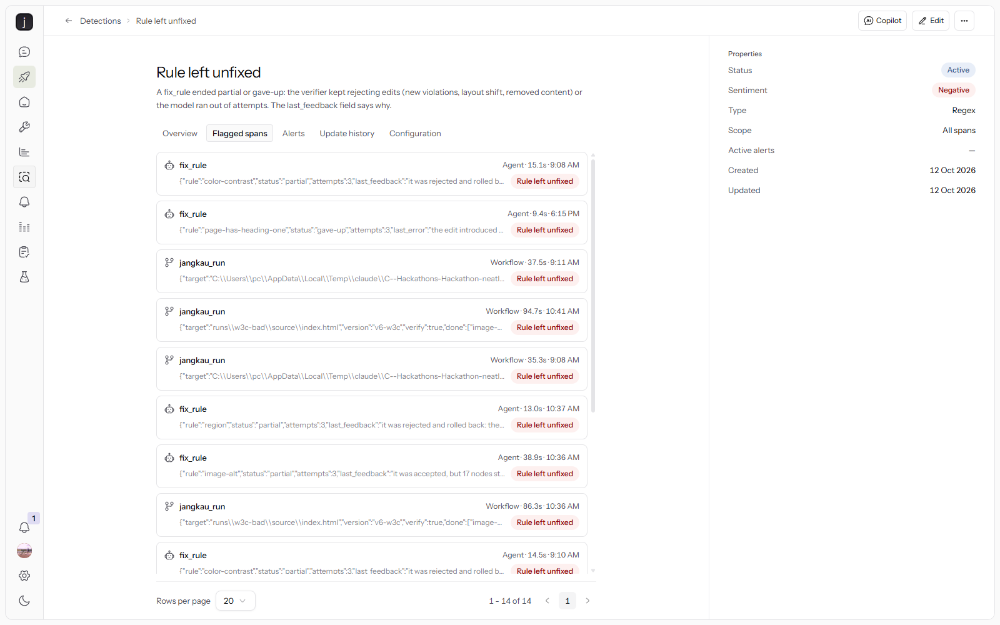

# Incidents found with neatlogs, and how each was resolved

Two neatlogs detections watch the agent:

- **Rule left unfixed** (custom, regex on span output `status.{1,4}(partial|gave-up)`): a `fix_rule` agent span
  that ended without fixing its rule. The span's `last_feedback` says why the verifier rejected the last edit.
  Backfilled over 1,135 spans it flagged 14, one per incident below.
- **Execution Failed** (built in, span status = ERROR): a tool span that threw, e.g. `apply_edits`.

| # | Detection hit | What the span showed | Root cause | Fix | After |
|---|---|---|---|---|---|
| 1 | Rule left unfixed: `label` gave-up, `page-has-heading-one` gave-up (v2, batik shop) | `last_error: the edit introduced new violations: {'region': 13}`, `{'heading-order': 1}` | The verifier treated growth in rules still waiting in the queue as breakage, so correct label fixes were rejected | Only regressions in finished rules or brand-new rules count | v2 47 → 14, v4 47 → **0** with fewer LLM calls |
| 2 | Rule left unfixed: `color-contrast` partial, 7 nodes (v4, StartBootstrap Freelancer) | `still has 7 failing nodes`, attempts rejected as "35% of pixels changed" | Darkening a brand-colour section repaints most of the page, so every correct contrast fix failed the pixel diff | Contrast fixes compare edge maps (layout), not raw pixels | 33 → 1 |
| 3 | Rule left unfixed: `color-contrast` partial, 1 node (v5-real) | `last_feedback: ... still has 1 failing nodes` and nothing else | Retries got no measurement, and Haiku stalled at 3.44:1 | Feedback carries the contrast axe measured on the rendered page; stuck rules escalate to claude-sonnet-4.6, which found Bootstrap's `.disabled { opacity: .65 }` | 33 → **0** |
| 4 | Execution Failed: `apply_edits` errors (W3C BAD demo, live URL) | `edit 16: find matched 0 times`; next span `image-alt` partial, 17 left | One mistyped `find` in a batch of 20 alt-text edits threw the whole batch away, and the 3-attempt cap stopped a rule that was still improving | Keep every valid edit and send the skipped ones back; progress earns another attempt; escalate after two stuck attempts in a row | 67 → 26 became 67 → **4** |
| 5 | Rule left unfixed: `region` partial, 4 nodes (W3C, still open) | `the edit introduced new violations {'landmark-main-is-top-level': 1}` | Table layout: a wrapper inserted between `<tr>`/`<td>` is moved out of the table by the HTML parser, so the model's landmarks end up nested or duplicated | Tried giving the model the rendered landmark tree plus a table-layout hint: 67 → 10 and 67 → 5 on two reruns, no better than 67 → 4. Reverted, still open | 4 `region` nodes left (moderate, best practice) |

Not from a detection, but found the same way, by reading the trace and the diff:

- An empty `<main></main>` passed `landmark-one-main`. The verifier now rejects any edit that adds an empty landmark.
- The first GitHub Actions run flagged the landing page itself: it was audited at first paint, mid contrast animation. Fixed with `--wait`.

Trace IDs: v2 `b8f4426cde45d1dadfae248a42540bba`, v4-real `0742cf0d9511d5bb8260b2629e338de8`,
v5-real `372b156982a2cc0fdd6c267c4b177430`, W3C first run `9ff55fc3a44ba2e98493a8f0892f6138`, W3C after the fix `2d5650d366105b38449d868f3b1d74cd`.
